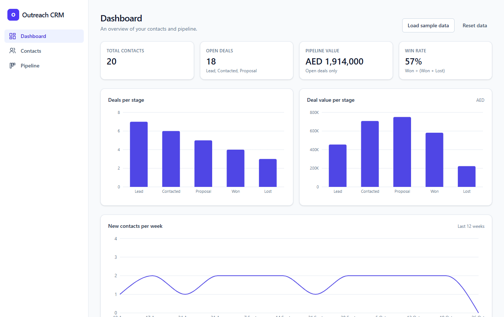
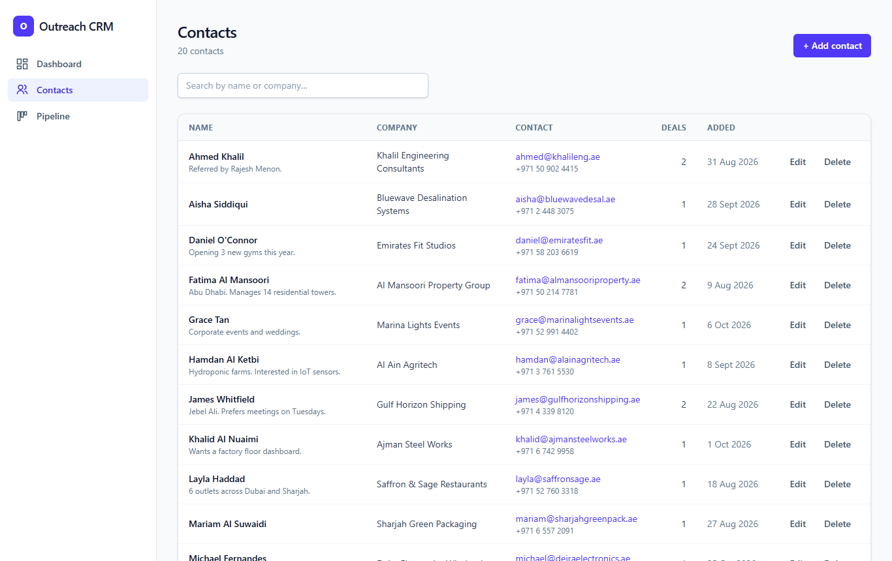
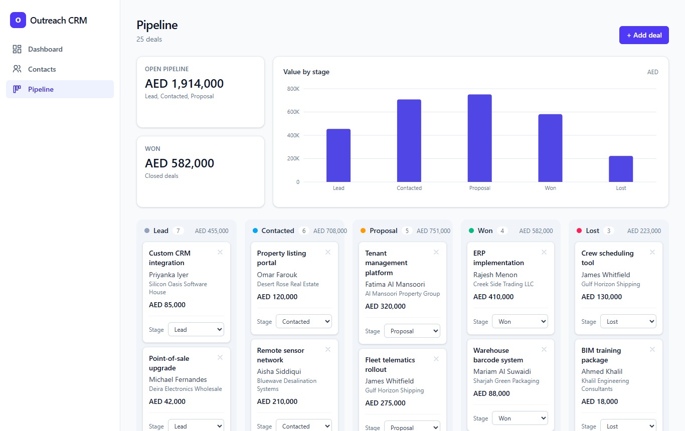

# Outreach CRM

Outreach CRM is a lightweight customer relationship manager for small business
development teams. It keeps the people you're reaching out to in one place,
tracks each deal from first lead to won or lost, and gives you a dashboard
showing how your pipeline is doing. It's designed for teams that have outgrown a
spreadsheet but don't need a full enterprise CRM. Everything runs in the
browser, so there's nothing to install on a server.

**Live demo:** [outreach-crm.example.com](https://outreach-crm.example.com) _(placeholder — replace with the deployed URL)_

## Features

- **Dashboard.** KPI cards for total contacts, open deals, pipeline value (AED)
  and win rate, plus charts of deals per stage, deal value per stage and new
  contacts per week.
- **Contacts.** A searchable list of contacts (search by name or company). Add,
  edit and delete contacts in a form that checks required fields and email
  format.
- **Pipeline board.** One column per stage (Lead, Contacted, Proposal, Won,
  Lost). Each deal card shows its title, contact, company and value in AED.
  Move a deal to another stage with the dropdown on its card.
- **Add deals for existing contacts.** Pick a contact, enter a title and value,
  and choose the starting stage.
- **Sample data.** One click loads 20 fictional UAE companies and 25 deals
  across every stage, so you can explore the app straight away. **Reset data**
  clears everything after a confirmation.
- **Works on phones and desktops.** On a phone, the sidebar becomes a top bar,
  the contacts table becomes a list of cards, and pipeline stages stack
  vertically.
- **Helpful empty states.** When a page has no data, it shows a short message
  and a button for the next step.
- **Data stays in your browser.** Contacts and deals are saved in localStorage,
  so they're still there when you reload the page.

## Tech stack

| Area      | Tools                                  |
| --------- | -------------------------------------- |
| Framework | React 18, TypeScript                   |
| Build     | Vite                                   |
| Styling   | Tailwind CSS v4                        |
| Charts    | Recharts                               |
| Storage   | Browser localStorage, behind a small data layer (`src/lib/storage.ts`) |

## Screenshots

| Dashboard | Contacts | Pipeline |
| --------- | -------- | -------- |
|  |  |  |

## Running locally

You need [Node.js](https://nodejs.org) 18 or newer.

```bash
git clone <your-repo-url> outreach-crm
cd outreach-crm
npm install
npm run dev
```

Then open http://localhost:5173. The app starts empty. Click **Load sample
data** on the Dashboard to fill it with demo data.

Other scripts:

```bash
npm run build     # type-check and build for production into dist/
npm run preview   # serve the production build locally
```

## Project structure

```
src/
  types/        Contact, Deal and Stage types
  lib/          Data layer, app state, validation, formatting, metrics, sample data
  components/   Reusable UI: forms, modal, cards, charts, empty states
  pages/        Dashboard, Contacts and Pipeline
```

Components never read or write localStorage directly. Everything goes through
the `CrmRepository` interface in `src/lib/storage.ts`, so the app can switch to
a real database without changing any components.

## Future improvements

- **Real database.** Write a version of `CrmRepository` that talks to an API
  backed by a database such as PostgreSQL or Supabase, so data is shared across
  devices and the whole team.
- **User logins.** Add accounts so each team member signs in, deals can be
  assigned to an owner, and changes are tracked by who made them.
- **CSV import/export.** Import existing contacts from a spreadsheet, and export
  contacts and deals for reporting.
- **Email integration.** Send emails from a contact's page and log them
  automatically, using Gmail or Outlook.
